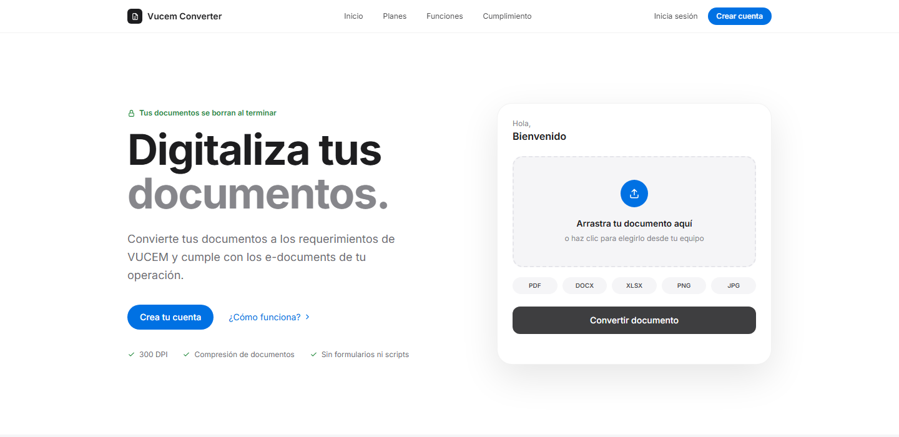
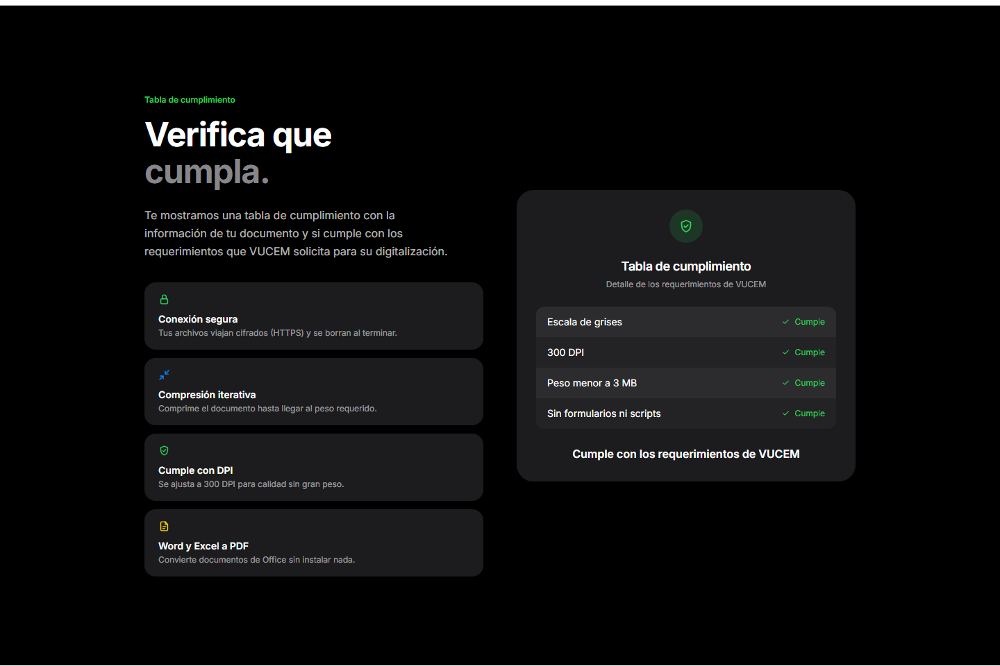
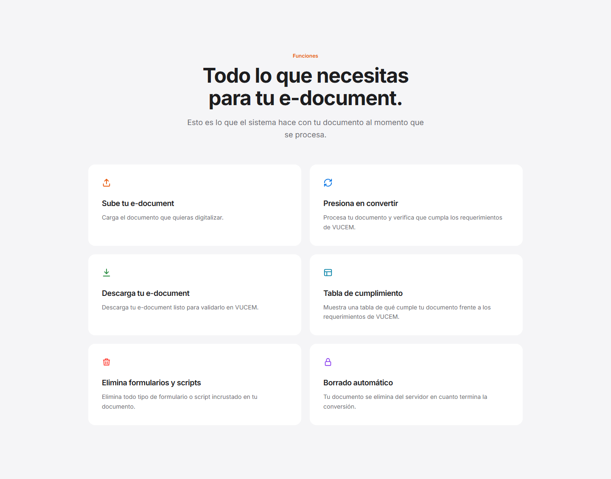
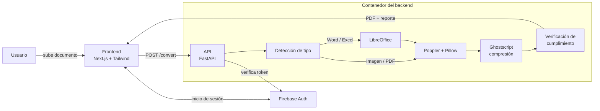
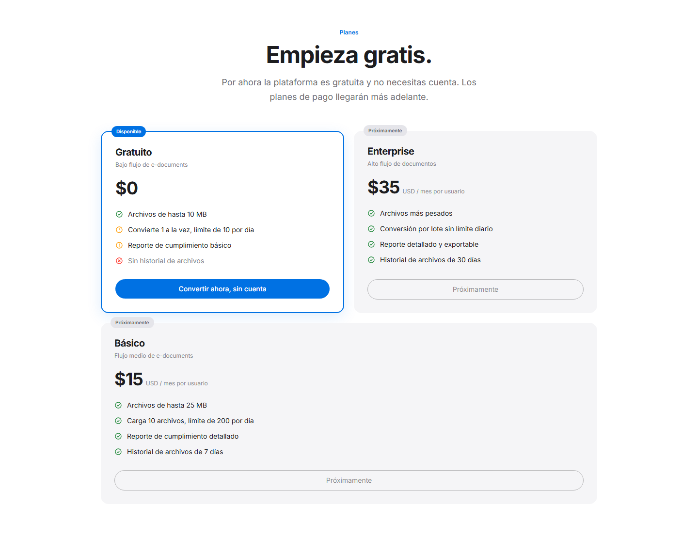
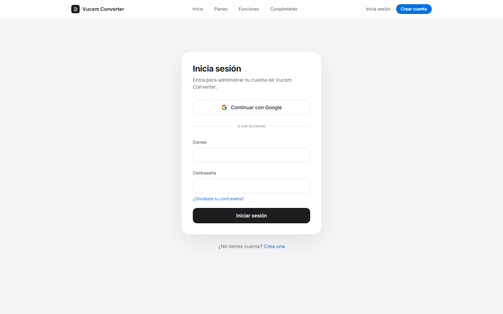

# Vucem Converter

**Convierte documentos al formato que exige VUCEM en segundos y verifica que cumplan antes de subirlos.**

🔗 **Demo en vivo:** _próximamente_ · 👤 **Autor:** [Luis Angel Gallegos](https://www.linkedin.com/in/luis-angel-gallegos-gomez/)

> _English summary: a full-stack web app that converts PDF, Word, Excel and image files into the strict format required by VUCEM (Mexico's single window for foreign trade): grayscale, 300 DPI, max 3 MB, no forms or scripts. It returns the converted PDF together with a compliance report. Built with Next.js, FastAPI, Ghostscript, LibreOffice and Firebase Auth. Source code is private; this repository documents the project._

---

## El problema

Los agentes aduanales y las empresas que importan o exportan deben subir sus documentos a la **Ventanilla Única de Comercio Exterior (VUCEM)** en un formato muy específico:

| Requisito | Valor exigido |
|---|---|
| Formato | PDF |
| Color | Escala de grises |
| Resolución | 300 DPI exactos |
| Peso máximo | 3 MB |
| Contenido | Sin formularios, objetos incrustados ni JavaScript |

Cumplirlo a mano significa escanear de nuevo, cambiar la configuración de la impresora o probar varias herramientas hasta que el archivo pase. Cuando VUCEM lo rechaza, casi nunca explica por qué.

## La solución

Vucem Converter recibe el documento tal como el usuario lo tiene (PDF, Word, Excel, PNG o JPG) y devuelve:

1. **El PDF listo para VUCEM:** convertido a grises y a 300 DPI, comprimido por debajo de 3 MB y sin formularios ni scripts.
2. **Una tabla de cumplimiento** que muestra, requisito por requisito, si el documento final cumple y por qué.

---

## Funciones

- **Formatos de entrada:** PDF, Word (.docx), Excel (.xlsx), PNG y JPG.
- **Detección del tipo real del archivo:** se valida por su contenido, no por la extensión. Rechaza archivos con macros (.docm/.xlsm), PDFs protegidos con contraseña y archivos dañados, con mensajes claros en español.
- **Compresión iterativa:** aumenta la compresión por niveles hasta bajar de 3 MB **sin reducir nunca la resolución** de 300 DPI.
- **Reporte de cumplimiento** que mide los valores reales del PDF final, en lugar de suponerlos.
- **Privacidad:** cada documento se procesa en una carpeta temporal propia que se borra al terminar. No se guarda ninguna copia.
- **Cuentas opcionales:** registro con correo (con verificación) o con Google. La conversión funciona sin cuenta.
- **Protección del servicio gratuito:** límite de conversiones diarias por visitante y de tamaño por archivo.

---

## Arquitectura

**Flujo de una conversión:**

1. El frontend valida el formato y el tamaño, y envía el archivo a la API.
2. La API detecta el tipo real del archivo y lo convierte a PDF; Word y Excel pasan por LibreOffice.
3. Cada página se rasteriza a 300 DPI en escala de grises. Así se eliminan formularios, scripts y objetos incrustados.
4. Ghostscript comprime por niveles hasta cumplir el peso.
5. Se verifica el PDF final y se devuelve junto con el reporte de cumplimiento.

---

## Tecnologías

| Capa | Tecnologías |
|---|---|
| Frontend | Next.js 16, React, TypeScript, Tailwind CSS 4 |
| Backend | Python 3.13, FastAPI, Uvicorn |
| Procesamiento | Ghostscript, LibreOffice (modo headless), Poppler, pikepdf, Pillow, libmagic |
| Autenticación | Firebase Authentication (correo y Google); tokens verificados en el backend con `google-auth` |
| Pruebas | pytest: 73 pruebas automatizadas, unitarias y de integración |
| Infraestructura | Docker; frontend en Vercel |

---

## Retos técnicos resueltos

Algunos problemas que aparecieron al llevar el prototipo a algo confiable:

- **El reporte decía "cumple" cuando no cumplía.** La verificación comparaba contra el ancho de una hoja carta, así que fallaba con hojas horizontales o tickets y aprobaba páginas a 150 DPI. Ahora mide los DPI reales: píxeles de la imagen entre pulgadas de la página.
- **La compresión bajaba la resolución en silencio.** Los perfiles estándar de Ghostscript reducían las imágenes a 150 o 72 DPI. Se reemplazaron por niveles de calidad JPEG que comprimen sin tocar la resolución.
- **Word y Excel se detectaban mal según el programa que los creó.** La librería de detección acertaba en 4 de 11 casos probados, rechazaba todos los Excel y aceptaba Word con macros. Ahora se lee el manifiesto interno del documento (`[Content_Types].xml`).
- **Una conversión bloqueaba al resto de los usuarios.** El endpoint corría trabajo pesado dentro del ciclo de eventos de FastAPI. Ahora corre en hilos aparte, y cada conversión de LibreOffice usa su propio perfil para poder ejecutar varias a la vez sin conflictos.
- **Los errores llegaban al navegador como "sin conexión".** Las respuestas de error no llevaban encabezados CORS. Ahora todas los llevan, y el usuario ve el mensaje real.
- **Validación segura de sesiones sin credenciales de servidor.** El backend verifica la firma de los tokens de Firebase y además comprueba su emisor (`iss`), una validación que la librería no hace por sí sola. Hay pruebas automatizadas con tokens firmados con llaves generadas para la prueba.

---

## Capturas

| Planes | Inicio de sesión |
|---|---|
|  |  |

---

## Estado y hoja de ruta

- [x] Motor de conversión y compresión
- [x] Validación y reporte de cumplimiento
- [x] Frontend con manejo de errores y estados de carga
- [x] Cuentas de usuario (correo y Google)
- [ ] Despliegue público
- [ ] Conversión por lote (varios documentos a la vez)
- [ ] Historial de conversiones por cuenta
- [ ] Planes de suscripción

---

## Sobre el código

El código fuente es privado porque el proyecto está pensado para crecer como servicio por suscripción. Si quieres conocer más detalles técnicos o ver el código durante una entrevista, escríbeme por [LinkedIn](https://www.linkedin.com/in/luis-angel-gallegos-gomez/).

---

Proyecto independiente. No está afiliado al SAT ni a la Ventanilla Única de Comercio Exterior (VUCEM).
